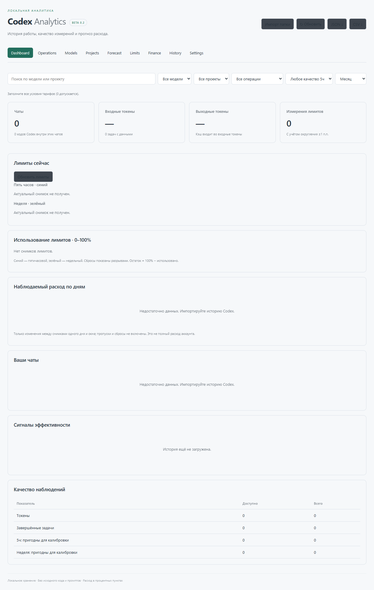

# Codex Analytics

**[Пошаговая инструкция установки и запуска](START.ru.md)**

Бета 0.2 добавляет импорт выбранной папки и архивных сессий, фильтры по операциям и качеству, экспорт выбранных данных и сохранение параметров панели. Прогнозы и аналитические отчёты рассчитываются в отдельном рабочем потоке. [Что изменилось](docs/release-0.2.md).

Расширение VS Code для локальной аналитики Codex. Сбор журналов, SQLite, проверка расхода лимитов, прогнозы по собственной истории и сравнение тарифных сценариев. Облачный сервер и API-ключ не нужны.



## Установка

Для сборки нужен Node.js 22 LTS:

```sh
npm ci
npm test
npm run package
code --install-extension codex-analytics-1.0.0.vsix
```

Готовый VSIX также устанавливается через **Extensions → … → Install from VSIX**. После установки выберите значок Analytics слева или команду **Codex Analytics: Open Dashboard** для широкой панели.

Настройки: `codexAnalytics.sessionsPath` — каталог журналов; `codexAnalytics.codexPath` — путь к Codex (при необходимости полный путь к `codex.exe`); `codexAnalytics.autoImport` — автоимпорт; `codexAnalytics.pollSeconds` — период опроса. По умолчанию журналы читаются из `CODEX_HOME/sessions` или `~/.codex/sessions`. Раздел Limits получает текущие лимиты через официальный Codex App Server с существующей авторизацией.

## Возможности

Dashboard показывает наблюдения и сигналы повторных действий. Operations содержит группировки и нормализованный расход. Models и Projects сравнивают агрегаты. Forecast оценивает следующую задачу по однотипной истории. Limits показывает два независимых окна и историю процентов. Finance сравнивает введённые пользователем условия. History содержит задачи; Settings открывает настройки VS Code. Доступны поиск, фильтры периода, модели и проекта, экспорт CSV/JSON.

Измеряются токены и кэш, время задач, вызовы инструментов, команды, обнаруженные тесты и ошибки, повторные одинаковые чтения и тесты. Подтверждённые успешные патчи дают количество добавленных/удалённых строк и событий создания/изменения файлов. Статистика содержит среднее, медиану, перцентили, стандартное отклонение и приближённый 95% интервал среднего.

Прогноз требует минимум 5 подходящих наблюдений на показатель. Он показывает эмпирические P10–P90, частоту попадания в остаток лимита и число похожих задач. Вероятности не являются гарантией. Для темпа расхода нужны 5 интервалов текущего окна. Входы сложности, размера проекта и будущих повторов пока не имеют обученных коэффициентов и явно не изменяют прогноз.

## Достоверность и ограничения

Расход лимитов выражается в **процентных пунктах**. Разница округлённых процентов имеет погрешность ±1 п.п. Сброс, пересечение задач, смена модели, пропуски и смешанные операции исключают наблюдение из обучения удельного расхода. Активность на других устройствах может быть не видна локально.

Число реально прочитанных файлов, их байты/строки/символы, число исправленных дефектов, семантические повторные попытки и фактический успех задачи не выводятся из произвольных shell-команд. Если данных нет, показывается «—» или «Недостаточно данных». Завершение turn не доказывает успешность результата. Классификация — эвристика инструментов; надёжно распознавать исправление ошибок, архитектуру и рефакторинг без отдельного подтверждения нельзя. [Подробный контракт измерений](docs/measurement.md).

База хранит агрегаты, хэши проектов и технические идентификаторы в глобальном хранилище расширения. Промпты, код, команды, пароли и токены авторизации не сохраняются. Для очистки отключите автоимпорт и удалите каталог global storage расширения. Исходные журналы не изменяются.

## Разработка и публикация

`npm test` запускает компиляцию и автоматические проверки. GitHub Actions собирает проект на Windows/Linux и прикладывает VSIX. `node scripts/screenshots.cjs` проверяет все разделы в headless Edge и создаёт скриншоты настоящего пустого состояния. Локальное сравнение тарифов использует только ваши цены и оценку ёмкости; стоимость API не подменяет расход подписки.

Готовые сборки доступны в [GitHub Releases](https://github.com/Noki1945/Codex-Analytics/releases). Для Marketplace создайте publisher, замените `publisher` в `package.json`, проверьте сборку, затем выполните `npx vsce login YOUR_PUBLISHER` и `npx vsce publish`. Подробности — в [английском README](README.md). Лицензия MIT. Независимый проект, не официальный продукт OpenAI.
