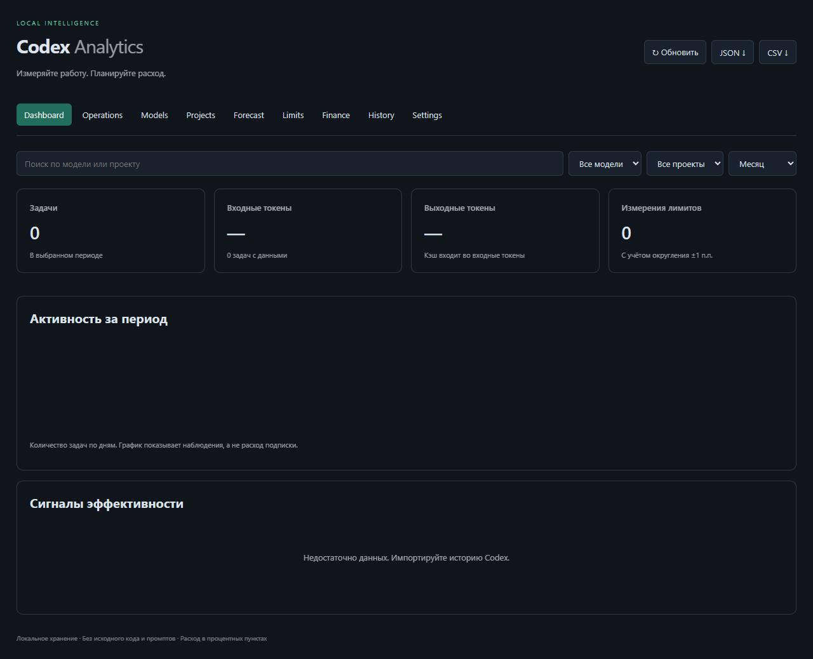

# Codex Analytics

A local-first VS Code extension for Codex session analytics, quota calibration, empirical forecasts and user-priced subscription scenarios. TypeScript, worker threads, SQLite (sql.js/WASM), no API key and no hosted backend.

[Русская документация](README.ru.md) · [Measurement limitations](docs/measurement.md)



## Install

Install Node.js 22 LTS to build from source, then run:

```sh
npm ci
npm test
npm run package
code --install-extension codex-analytics-0.1.0.vsix
```

Alternatively use **Extensions → … → Install from VSIX**. Open the Analytics Activity Bar icon or run **Codex Analytics: Open Dashboard** for a full-width panel. Configure `codexAnalytics.codexPath` to the full path to `codex.exe` if Codex is not on VS Code's PATH. Existing Codex authentication is reused for the official read-only App Server quota request. Importing session logs works offline.

## What works

- Incremental newline-delimited JSON import from `CODEX_HOME/sessions` (otherwise `~/.codex/sessions`), partial-line buffering, replacement/truncation detection and task ID deduplication.
- Local cumulative token deltas, cached token accounting, observed task durations, tool/command/test counts, detected failures and repeated identical read/test calls.
- Successful `apply_patch` summaries: added/deleted lines, file creation/change **events**, generated Unicode code points. Only explicitly confirmed successful patches contribute.
- Multi-label tool-based classification, independent five-hour/week windows, reset/bucket/model/gap/overlap checks and percentage-point rounding bounds.
- Mean, median, P10/P90, sample deviation, approximate Student-t mean confidence intervals, sample counts and normalized quotas by volume. Filters apply before aggregation.
- History-based per-model/per-operation predictions with empirical intervals, fit frequencies and remaining similar-task counts (minimum five qualified observations). No synthetic fallback values.
- Independent observed quota burn rates and exhaustion estimates when at least five intervals within the same current quota window exist.
- Nine webview sections, VS Code theme variables, search/model/project/time filters, quota history plots, JSON/CSV export and manually priced finance scenarios.

## Trust and privacy

Session logs contain sensitive text; the importer transiently reads them but persists only allowlisted aggregates, project hashes and technical IDs. It does not read authentication files, store prompts/source/commands, or send code to any service. SQLite is stored in the extension's global storage directory. Delete that directory to clear the database; turn off auto-import first. No telemetry is implemented.

Quota differences are account-level observations, **not exact per-operation billing**. Other clients can contribute even when local logs do not overlap. Percentages usually have one-point resolution, so differences are reported with ±1 percentage point bounds. Mixed or contaminated tasks are excluded from unit-cost training. API token prices are never equated with subscription credits. See the detailed [measurement contract](docs/measurement.md).

## Development and publishing

`npm test` compiles and runs Node's test suite, including incremental import, quota resets/concurrency, Unicode and held-out prediction fixtures. `node scripts/screenshots.cjs` runs a headless Edge UI smoke test and regenerates genuine empty-state screenshots on Windows; on Linux install Playwright Chromium first. Screenshots contain no invented usage.

GitHub Actions builds/tests/packages on Windows and Linux and uploads VSIX artifacts. Download the installable alpha from [GitHub Releases](https://github.com/Noki1945/Codex-Analytics/releases).

To publish in Marketplace: create your publisher in the [official management portal](https://marketplace.visualstudio.com/manage), replace the local `publisher` in `package.json`, add your actual repository URL and icon as desired, run `npm ci && npm test && npm run package`, inspect the package, then use `npx vsce login YOUR_PUBLISHER` and `npx vsce publish`. Do not commit credentials. Publishing is a separate explicit action.

MIT licensed. This is an independent project, not an official OpenAI product.
